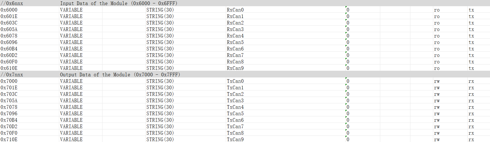
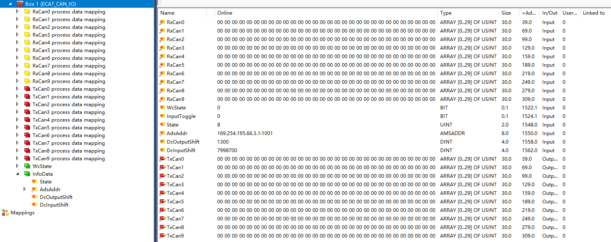
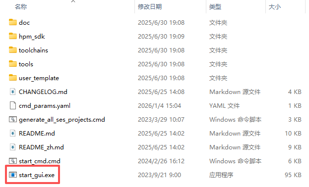
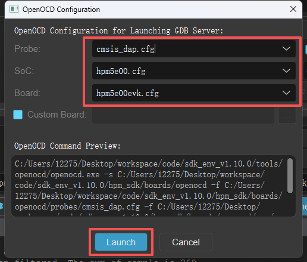
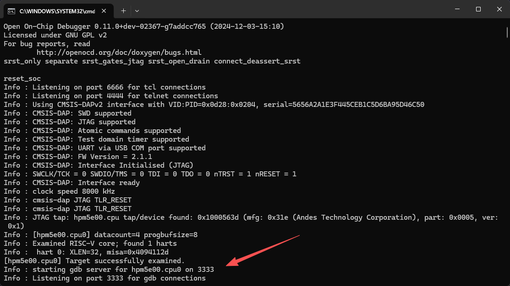
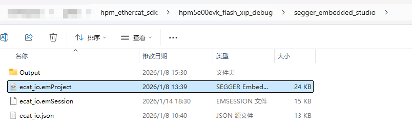
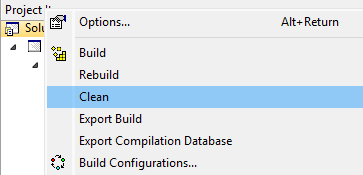
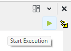

# KH-EtherCAT-CANFDX4-OP

## 介绍

本项目是基于 HPMicro HPM5E31 开发的 EtherCAT ↔ 4× CAN FD 双向数据桥接开源解决方案。

HPM 原本 ECAT IO 示例介绍可查看 [README_zh.rst](/Firmware/hpm_ethercat_sdk/README_zh.rst)

### 数据流向

#### CAN → EtherCAT 数据流

```
CAN 接收帧
    ↓
RxCan 缓冲区
    ↓
APPL_InputMapping()
    ↓
EtherCAT 输入过程数据
    ↓
主站读取
```

#### EtherCAT → CAN 数据流

```
主站写入
    ↓
EtherCAT 输出过程数据
    ↓
APPL_OutputMapping()
    ↓
TxCan 缓冲区
    ↓
can_app_process_txcanX_transmit()
    ↓
CAN 发送帧
```

---

## 固件说明

本设备作为 EtherCAT 从站设备的对象字典，配置 10 组输入对象和 10 组输出，每组可存储最多 30 字节的数据（以 STRING(30) 格式表示）。



### EtherCAT 与 CAN 映射

设备从站总的输出和输入，分别可存储 300 字节。

设备的四个通道，每通道分配 75 字节，用于交换 CAN FD 帧数据，包括 CAN ID、DLC 和 64 位数据信息。

以 TwinCAT 显示为例：



#### 输入过程数据映射

| CAN 通道 | 内部变量 | PDO 偏移 | 字节范围 | 描述 |
|---------|---------|---------|---------|------|
| **CAN0** | RxCan00x6000 | 0 | 0-29 | CAN0 接收区 |
| **CAN0** | RxCan10x601E | 30 | 30-59 | CAN0 接收区 1 |
| **CAN0** | RxCan20x603C | 60 | 60-74 | CAN0 接收区 2（仅前 15 字节） |
| **CAN1** | RxCan20x603C | 75 | 75-89 | CAN1 接收区 1（后 15 字节） |
| **CAN1** | RxCan30x605A | 90 | 90-119 | CAN1 接收区 2 |
| **CAN1** | RxCan40x6078 | 120 | 120-149 | CAN1 接收区 3 |
| **CAN2** | RxCan50x6096 | 150 | 150-179 | CAN2 接收区 1 |
| **CAN2** | RxCan60x60B4 | 180 | 180-209 | CAN2 接收区 2 |
| **CAN2** | RxCan70x60D2 | 210 | 210-224 | CAN2 接收区 3（仅前 15 字节） |
| **CAN3** | RxCan70x60D2 | 225 | 225-239 | CAN3 接收区 1（后 15 字节） |
| **CAN3** | RxCan80x60F0 | 240 | 240-269 | CAN3 接收区 2 |
| **CAN3** | RxCan90x610E | 270 | 270-299 | CAN3 接收区 3 |

#### 输出过程数据映射

| CAN 通道 | 内部变量 | PDO 偏移 | 字节范围 | 描述 |
|---------|---------|---------|---------|------|
| **CAN0** | TxCan00x7000 | 0 | 0-29 | CAN0 发送区 |
| **CAN0** | TxCan10x701E | 30 | 30-59 | CAN0 发送区 1 |
| **CAN0** | TxCan20x703C | 60 | 60-74 | CAN0 发送区 2（仅前 15 字节） |
| **CAN1** | TxCan20x703C | 75 | 75-89 | CAN1 发送区 1（后 15 字节） |
| **CAN1** | TxCan30x705A | 90 | 90-119 | CAN1 发送区 2 |
| **CAN1** | TxCan40x7078 | 120 | 120-149 | CAN1 发送区 3 |
| **CAN2** | TxCan50x7096 | 150 | 150-179 | CAN2 发送区 1 |
| **CAN2** | TxCan60x70B4 | 180 | 180-209 | CAN2 发送区 2 |
| **CAN2** | TxCan70x70D2 | 210 | 210-224 | CAN2 发送区 3（仅前 15 字节） |
| **CAN3** | TxCan70x70D2 | 225 | 225-239 | CAN3 发送区 1（后 15 字节） |
| **CAN3** | TxCan80x70F0 | 240 | 240-269 | CAN3 发送区 2 |
| **CAN3** | TxCan90x710E | 270 | 270-299 | CAN3 发送区 3 |

#### CAN 消息数据格式详解

各通道数据分配如下：

| 字节范围 | 用途 | 大小 | 说明 |
|---------|------|------|------|
| 0-3 | CAN ID | 4 字节 | 32 位标识符，可记录扩展帧 ID |
| 4 | DLC | 1 字节 | 数据长度码（0-15） |
| 5-68 | CAN 数据 | 64 字节 | 可记录完整 CAN FD 数据 |
| 69-74 | 保留 | 6 字节 | 备用空间，可用于扩展 |

---

## 固件烧录说明

### 使用 HPM SDK 项目生成器连接开发板

- 运行 `start_gui.exe`



- 配置运行 GDB 服务



- 成功连接后终端将显示如下信息：



### 使用 SEGGER 烧录程序

- 进入图示路径，双击自动启动 SEGGER Embedded Studio



- 执行 Clean → Build 编译工程



- 最后启动运行


