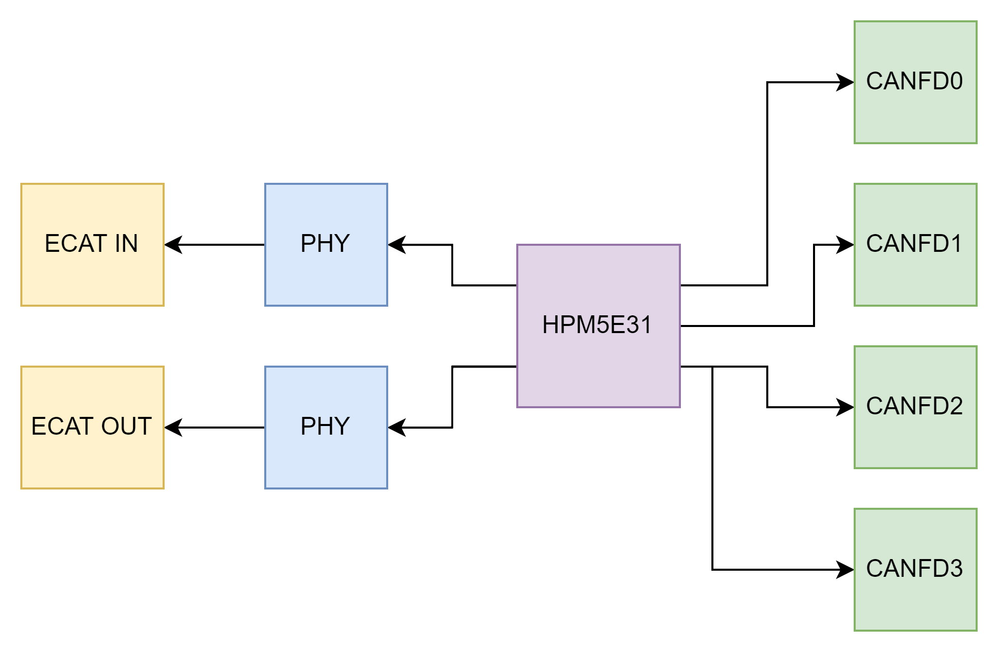
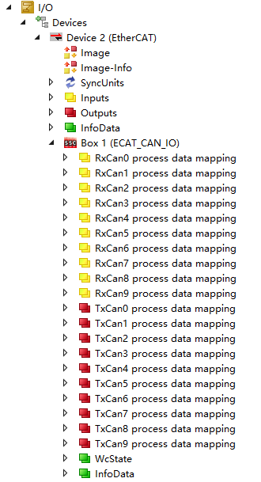
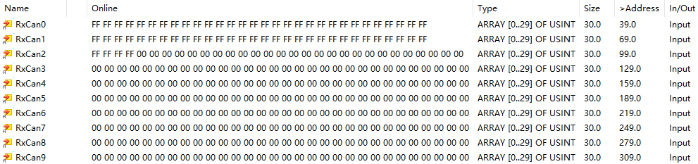
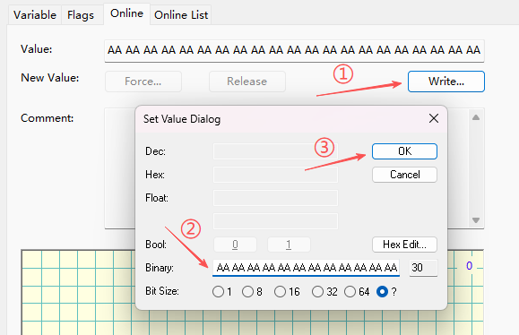
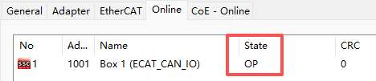
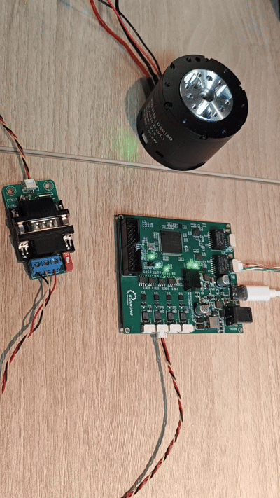
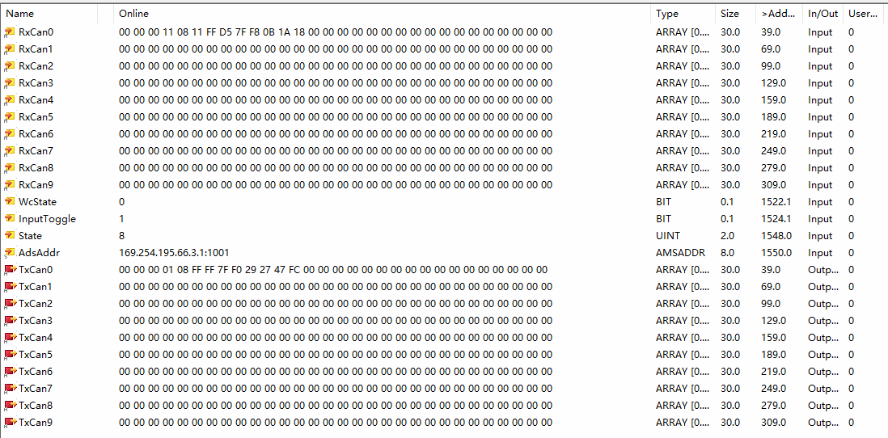
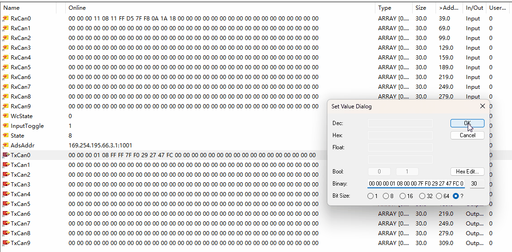
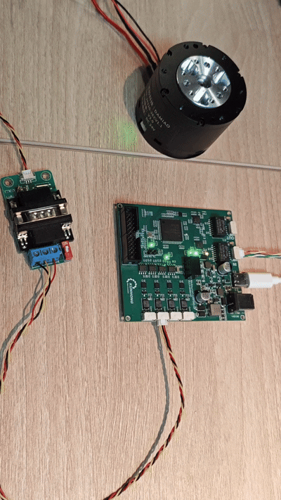

# KH-EtherCAT-CANFDX4-OP

EtherCAT ↔ 4× CAN FD 双向数据转发开源解决方案

---

#### 🌟 介绍

KH-EtherCAT-CANFDX4-OP 是一款开源硬件模块，模块基于 HPMicro HPM5E31 微控制器开发，实现 EtherCAT 与 四通道 CAN FD 总线之间的实时双向数据转发。

模块主要功能：
- **Input（输入）**：ECAT 主站 → ECAT 从站（接收 CAN 数据，或接收主站下发的状态/控制指令）
- **Output（输出）**：ECAT 从站 → ECAT 主站（发送 CAN 数据，或向上层反馈状态）


---

#### 🔧 主要特性

- EtherCAT ↔ CAN FD 双向透明传输（支持 PDO/SDO 映射）
- 支持四路 CAN FD 高波特率通信，兼容传统 CAN 2.0
- 支持 EtherCAT 多从站级联
- 开源方案降低工业通信集成成本

---
#### 📦 开源与商业化支持

本项目开源硬件设计方案及基础测试固件源码。开源用户可参考本项目内容自行设计软硬件。

##### 开源支持说明

- 我们不对开源用户提供单独的技术支持
- 相关技术问题可在本项目新建 [Issue](https://gitee.com/ChengDu-KunHong/kh-ethercat-canfdx4-op/issues)
- 采购成品板卡的用户，我们对板卡提供 3 个月硬件质保

##### 用户基础要求

用户需具备以下基础，或自行学习相关内容，我们不提供相关软件和技术支持：

- EtherCAT 主站软件使用
- EtherCAT 从站固件开发
- CAN FD 相关基础知识
- HPM 先楫芯片开发基础

##### 商业化定制支持

本项目支持按客户需求进行商业化定制，包括但不限于：

- **硬件定制**：尺寸、接口、温度等级、防护要求等
- **固件定制**：ESI 文件修改、通讯协议、其他固件功能

##### 成品板卡购买

Coming soon

##### 联系我们

- 联系方式：[点击查看](https://gitee.com/ChengDu-KunHong/cd-kunhong#%E8%81%94%E7%B3%BB%E6%88%91%E4%BB%AC)

---
#### 🛠️ 硬件架构


详细硬件设计详细说明请参考 [Hardware/README.md](Hardware/README.md#-硬件架构)

#### 💾 固件
**功能测试固件**

本项目提供开源测试固件，开源测试固件可满足基本的硬件测试验证。
测试固件具备以下特性

 - EtherCAT从站，包含PHY配置和先楫内置ESC驱动代码，可连接TwinCAT进行测试
 - 4通道CANFD驱动，支持独立的4路CANFD进行报文收发
 - 协议转发demo，固件包含EtherCAT转4路CANFD转发逻辑。连接TwinCAT后可进行4路CANFD报文的收发内容控制
测试固件代码及文档详见[Frimware/README.md](Firmware\README.md)

##### 通讯协议

通讯协议参照智元灵犀 X1 域控制器 DCU

https://www.zhiyuan-robot.com/DOCS/PM/DCU

---

#### 🚀 快速上手

若不需要调试，可直接从第三步进行测试。

##### 1. 开发环境准备

**硬件连接**
- 设备供电：TypeC 或 12V DC 电源
- 四路 CAN 接口（GH1.25 接口）与对端设备连接（波特率默认设置 1M/5M）
- 连接网线，作为从站时连接 IN 即可；级联时额外使用 OUT 连接下一个从站的 IN
- 连接串口线：用于烧录和调试

**软件工具安装**
- HPM SDK 项目生成工具（连接芯片）
- SEGGER Embedded Studio（开发工具）
- TwinCAT 3（作为 EtherCAT 主站）

##### 2. 编辑并下载固件


##### 3. EtherCAT 从站连接（TwinCAT 配置）

- 启动 TwinCAT 3，按照官方指南完成主站配置：
  https://hpm-sdk.readthedocs.io/zh-cn/latest/samples/ethercat/ecat_io/README_zh.html

- 成功连接后，TwinCAT I/O 映射界面将显示如下：



> ⚠️ 若未识别设备，请确认：
> 1. EtherCAT 网线连接正常
> 2. 设备已正确烧录含 ESI 描述文件的固件，并正常运行
> 3. ESI 文件已复制至 `C:\TwinCAT\3.1\Config\Io\EtherCAT\`

##### 4. 连接测试

**4.1 CAN 数据接收测试（主站 → 从站）**
- 使用对端 CAN 设备，向 CAN0 通道发送数据（例如：ID=0x100，64 字节全为 0xFF）
- 在 TwinCAT 的 RxCan 区域查看数组，应能读取到对应数据：



**4.2 CAN 数据发送测试（从站 → 外部设备）**
- 在 TwinCAT 的 TxCan 区域修改数组内容（例如：将 TxCan0 字节设置为全 AA）



- 对端 CAN 设备应收到对应报文：


> 📌 注意：每路 CAN 通道映射 75 字节缓冲区（实际使用前 64 字节）

---

#### ✅ 测试成功标志

- TwinCAT 显示从站状态为 OP（Operational）



- CAN 收发数据与预期一致
- TwinCAT 无异常错误告警

#### 电机控制demo

使用本设备控制电机运行。

- 设备处于ecat从站工作模式
- can接口连接电机,通道接口识别到对端CAN设备后，保持发送状态（绿灯闪烁）。   

- 观察twincat界面，可以观察到接收和发送的CAN帧信息


```
RxCan显示CAN0持续接收电机的CAN帧信息，电机持续发送ID为11，长度为8的状态数据。
TxCan显示CAN0通道发送的CAN帧信息，持续发送信息ID为1，长度为8的控制数据。（对应MIT的控制指令）
```

- 修改TxCan控制信息，观察电机响应
    


- 电机响应符合预期，测试成功
