# KH-EtherCAT-CANFDX4-OP

EtherCAT ↔ 4× CAN FD 双向数据桥接开源解决方案

---

#### 🌟 介绍

KH-EtherCAT-CANFDX4-OP 是一款开源硬件模块，模块基于 HPMicro HPM5E31 微控制器开发，实现 EtherCAT 与 四通道 CAN FD 总线之间的实时双向数据桥接。

模块主要功能：
- **Input（输入）**：ECAT 主站 → ECAT 从站（接收 CAN 数据，或接收主站下发的状态/控制指令）
- **Output（输出）**：ECAT 从站 → ECAT 主站（发送 CAN 数据，或向上层反馈状态）

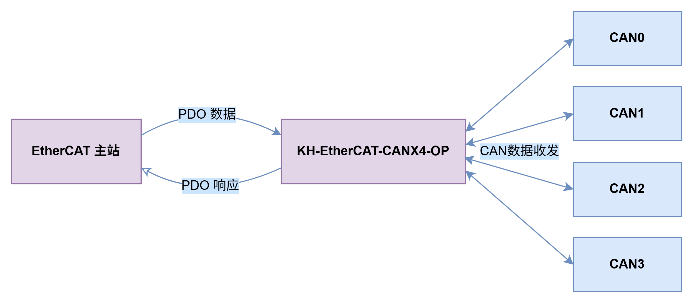

---

#### 🔧 主要特性

- EtherCAT ↔ CAN FD 双向透明传输（支持 PDO/SDO 映射）
- 支持四路 CAN FD 高波特率通信，兼容传统 CAN 2.0
- 支持 EtherCAT 多从站级联
- 开源方案降低工业通信集成成本

---

#### 🛠️ 硬件架构

硬件架构说明

##### 主控：HPM5E31

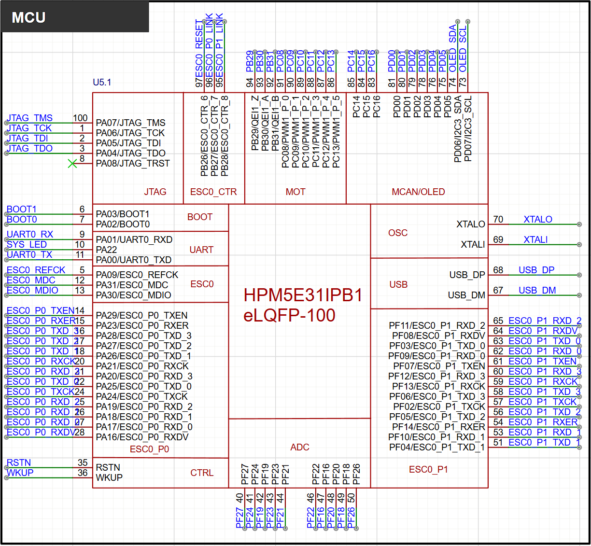

##### EtherCAT

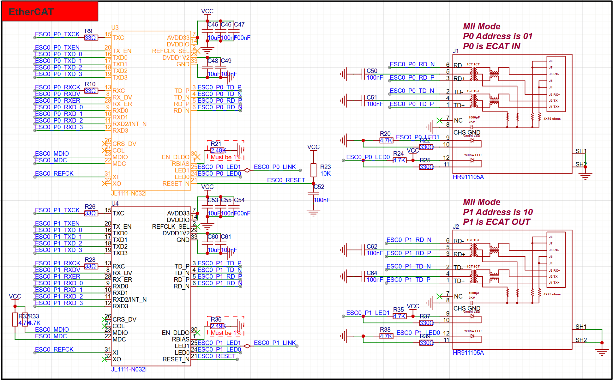

##### 四通道 CAN FD

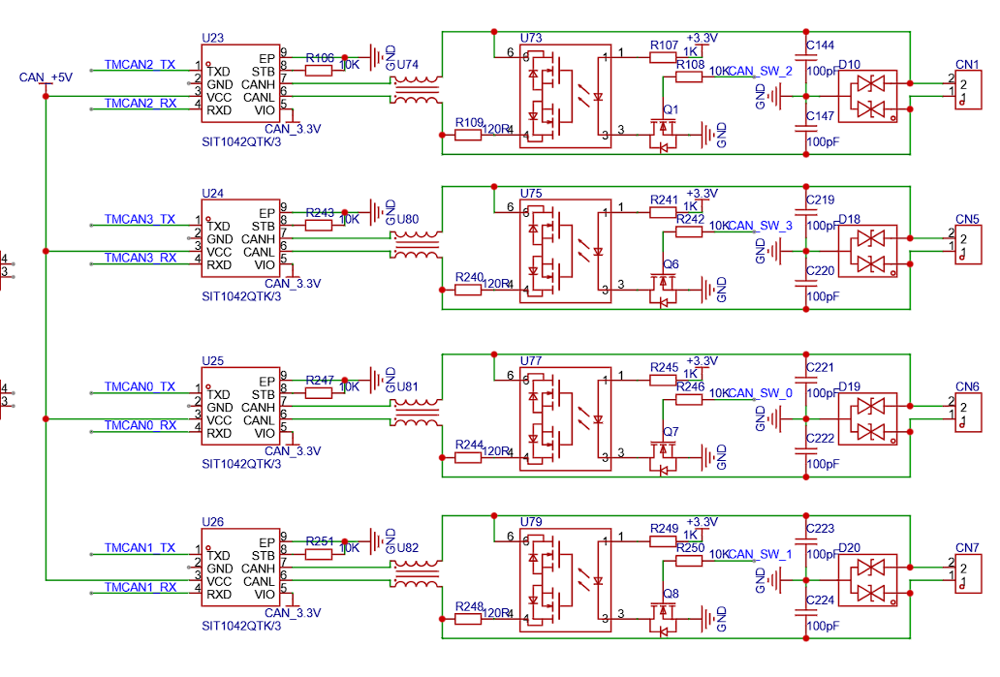

##### 通讯协议

通讯协议参照智元灵犀 X1 域控制器 DCU

https://www.zhiyuan-robot.com/DOCS/PM/DCU

---

#### 🚀 快速上手

若不需要调试，可直接从第三步进行测试。

##### 1. 开发环境准备

**硬件连接**
- 设备供电：TypeC 或 12V DC 电源
- 四路 CAN 接口（GH1.25 接口）与对端设备连接（波特率默认设置 1M/5M）
- 连接网线，作为从站时连接 IN 即可；级联时额外使用 OUT 连接下一个从站的 IN
- 连接串口线：用于烧录和调试

**软件工具安装**
- HPM SDK 项目生成工具（连接芯片）
- SEGGER Embedded Studio（开发工具）
- TwinCAT 3（作为 EtherCAT 主站）

##### 2. 固件烧录

**2.1 使用 HPM SDK 项目生成器连接对应开发板**
- 运行 `start_gui.exe`

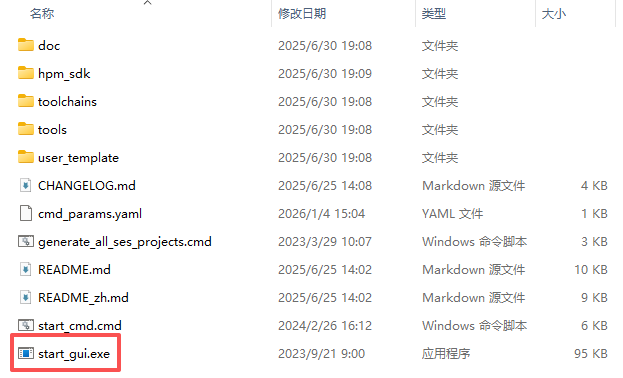

- 配置运行 GDB 服务

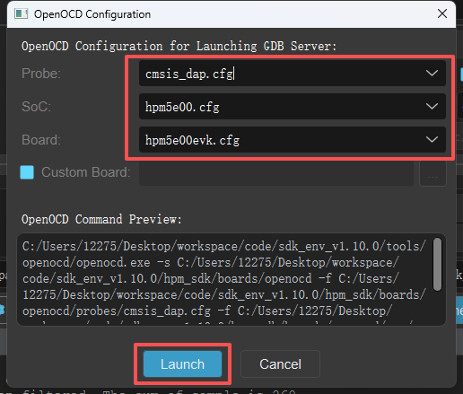

- 成功连接后终端将显示如下信息：

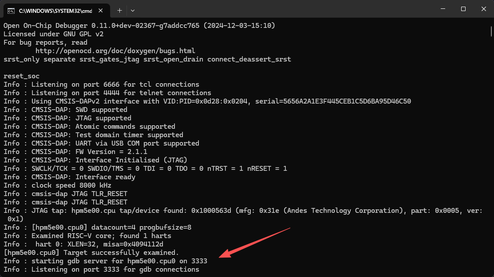

**2.2 使用 SEGGER 烧录程序**
- 进入图示路径，双击自动启动 SEGGER Embedded Studio

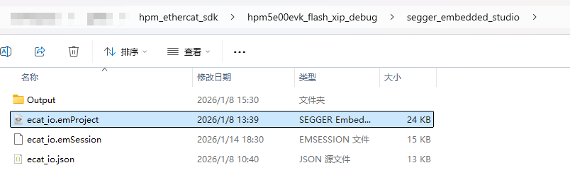

- 执行 Clean → Build 编译工程

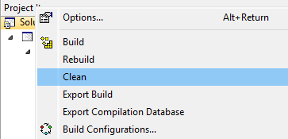

- 最后启动运行

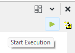

##### 3. EtherCAT 从站连接（TwinCAT 配置）

- 启动 TwinCAT 3，按照官方指南完成主站配置：
  https://hpm-sdk.readthedocs.io/zh-cn/latest/samples/ethercat/ecat_io/README_zh.html

- 成功连接后，TwinCAT I/O 映射界面将显示如下：

> ⚠️ 若未识别设备，请确认：
> 1. EtherCAT 网线连接正常
> 2. 设备已正确烧录含 ESI 描述文件的固件，并正常运行
> 3. ESI 文件已复制至 `C:\TwinCAT\3.1\Config\Io\EtherCAT\`

##### 4. 连接测试

**4.1 CAN 数据接收测试（主站 → 从站）**
- 使用对端 CAN 设备，向 CAN0 通道发送数据（例如：ID=0x100，64 字节全为 0xFF）
- 在 TwinCAT 的 RxCan 区域查看数组，应能读取到对应数据：

**4.2 CAN 数据发送测试（从站 → 外部设备）**
- 在 TwinCAT 的 TxCan 区域修改数组内容（例如：将 TxCan0 字节设置为全 AA）

- 对端 CAN 设备应收到对应报文：

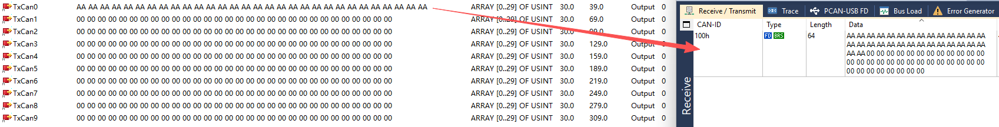

> 📌 注意：每路 CAN 通道映射 75 字节缓冲区（实际使用前 64 字节）

---

#### ✅ 测试成功标志

- TwinCAT 显示从站状态为 OP（Operational）

- CAN 收发数据与预期一致
- TwinCAT 无异常错误告警
